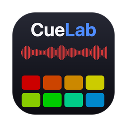
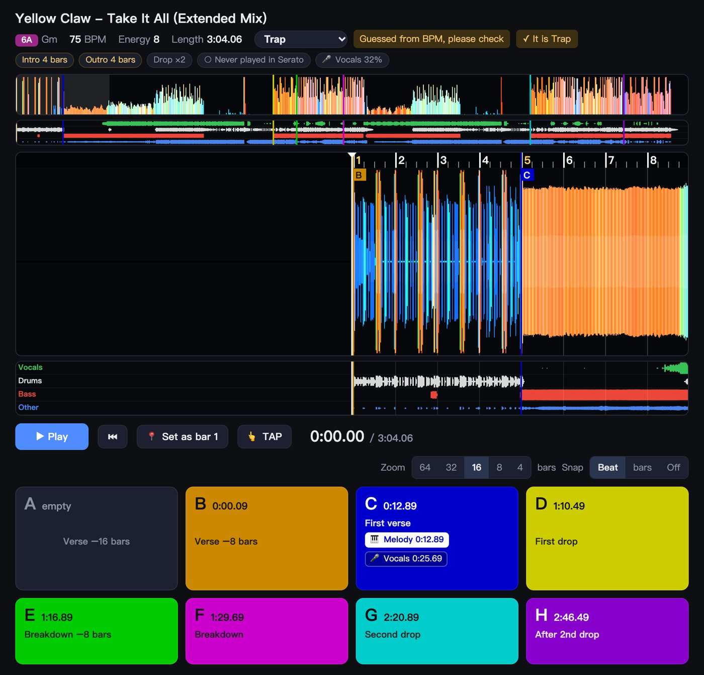
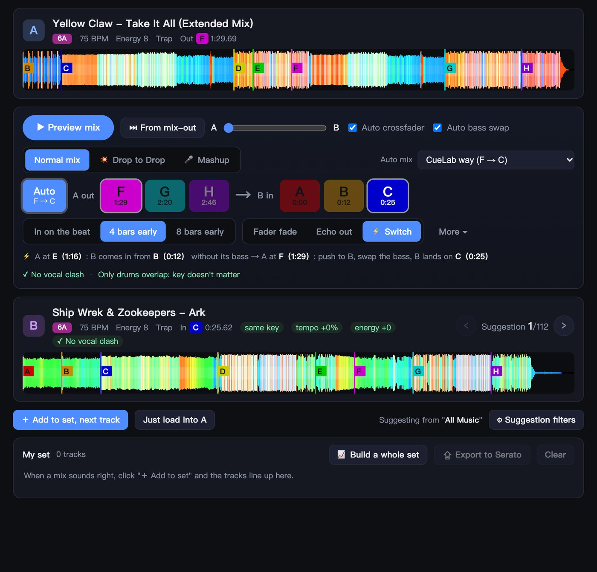
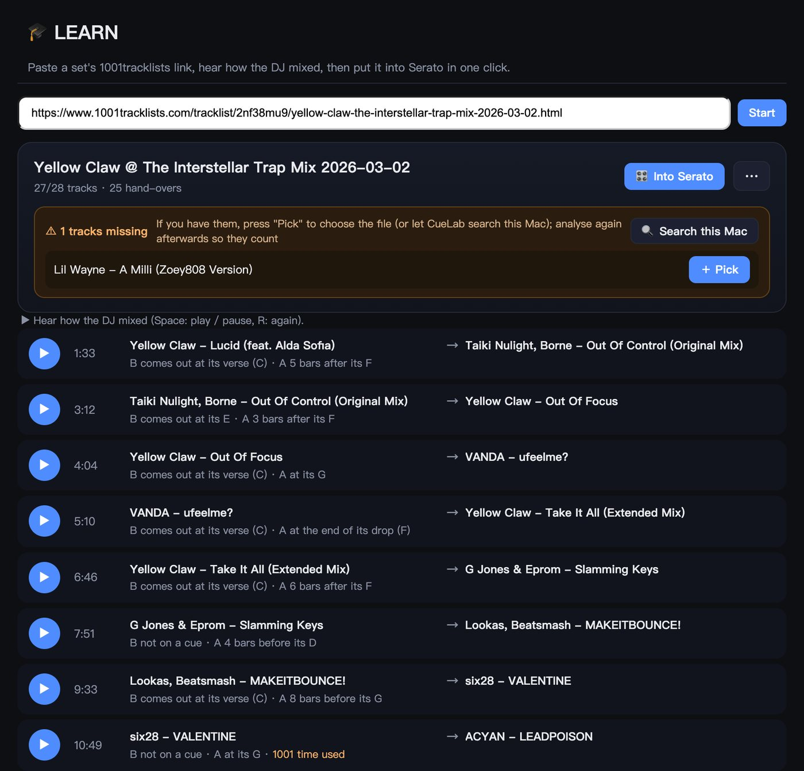

<h1 align="center">CueLab</h1>

<b>Eight cues. One click.</b> A Mac tool for DJs who play on Serato DJ Pro.

  <a href="https://github.com/CueLab-Lin/cuelab/releases/latest/download/CueLab-mac.zip"><b>⬇ Download for Mac (free)</b></a> ·
  <a href="https://cuelab-lin.github.io/cuelab/">Website</a> ·
  <a href="#中文">中文</a>

---

CueLab analyses your tracks and sets cues **A to H** for you, suggests what to play next, lets you hear the mix before you play it, learns from real DJ sets on 1001tracklists, and puts it all into **Serato DJ Pro** in one tap.

## What it does

| | |
|---|---|
| **CUE** | Drop in a folder and every track gets the same 8 cue points: before the verse, first verse, first drop, breakdown, second drop and more. About 10 seconds a track. Key, BPM, energy and vocals included. |
| **MIX** | Suggestions for the next track by key, tempo, energy and vocals. Press preview to hear A's **F** hand over to B's **C**, both decks beat-matched. |
| **SET** | Build a whole set from your library along an energy curve: warm-up, always up, classic arc or peak time. |
| **LEARN** | Paste a 1001tracklists link. CueLab finds the tracks on your Mac and shows every hand-over: which cue B comes out of and where A leaves. |
| **Serato** | Cues, genres and whole sets go into Serato DJ Pro. Your existing cues are backed up first, and tracks you cued by hand are skipped. |

## Install

1. [Download CueLab-mac.zip](https://github.com/CueLab-Lin/cuelab/releases/latest/download/CueLab-mac.zip) and double-click it to unzip.
2. Drag **CueLab.app** into **Applications**.
3. First launch: **right-click CueLab → Open**, then click **Open**.
   Still blocked? Go to **System Settings → Privacy & Security** and click **Open Anyway** next to CueLab.
4. Quit Serato DJ Pro before writing cues to Serato.

**Needs:** a Mac with Apple silicon (M1 or newer), macOS 12 or later, about 1.2 GB of space.

**Privacy:** CueLab runs on your Mac. Your music and your analysis results never leave it.

## Questions and feedback

Open an [issue](https://github.com/CueLab-Lin/cuelab/issues) or find **DJ LIN** on Threads.

---

## 中文

**CueLab：8 個 Cue，一鍵打好。** 給用 Serato DJ Pro 的 DJ 的 Mac 小工具。

- **CUE**：整個資料夾丟進去，每首歌自動打好 A 到 H 八個 Cue 點，一首約 10 秒，調性、BPM、能量、人聲一起算好
- **MIX**：照調性、速度、能量、人聲推薦下一首，一鍵試聽 A 的 F 切到 B 的 C，兩台精準對拍
- **SET**：照能量曲線一鍵排一整套
- **LEARN**：貼上 1001tracklists 網址，看名 DJ 每一次怎麼換歌
- **Serato**：Cue 點、流派、整套歌單一鍵放進 Serato DJ Pro，寫入前會先備份

**安裝：** [下載 CueLab-mac.zip](https://github.com/CueLab-Lin/cuelab/releases/latest/download/CueLab-mac.zip) → 解壓縮 → 把 CueLab.app 拖進「應用程式」→ 第一次在 CueLab 上 **按右鍵 → 打開**（還是被擋就到「系統設定 → 隱私權與安全性」按「強制打開」）。打開後右上角可以切換中文。

**需要：** Apple 晶片 Mac（M1 以上）、macOS 12 以上、約 1.2 GB 空間。

---

© 2026 DJ LIN. All rights reserved. CueLab is free to download and use; see [LICENSE](LICENSE). The program's source code is not published here.
Serato DJ Pro is a trademark of Serato. CueLab is not affiliated with Serato.
